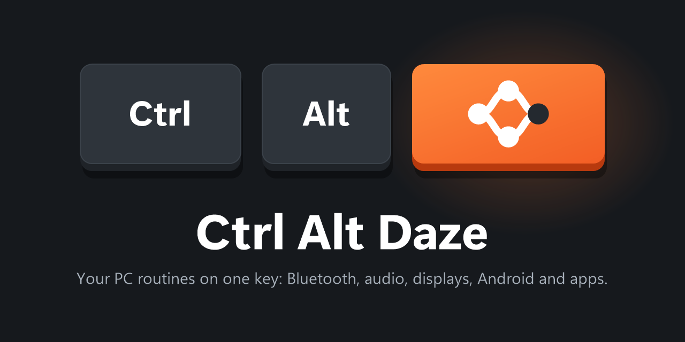
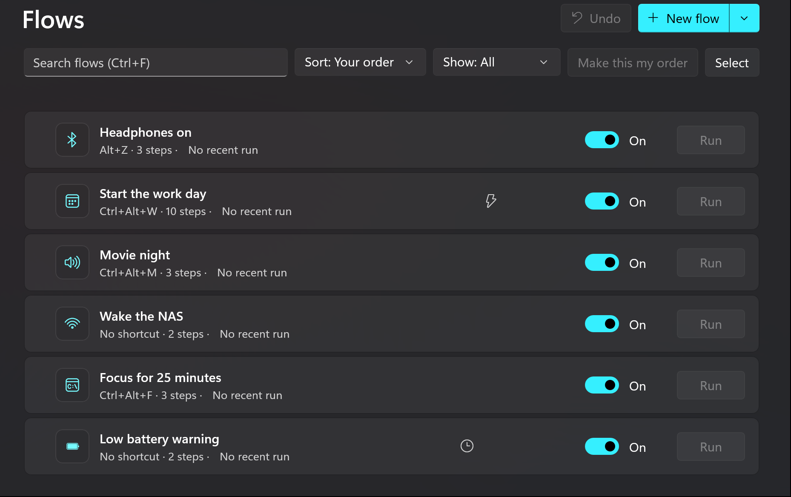
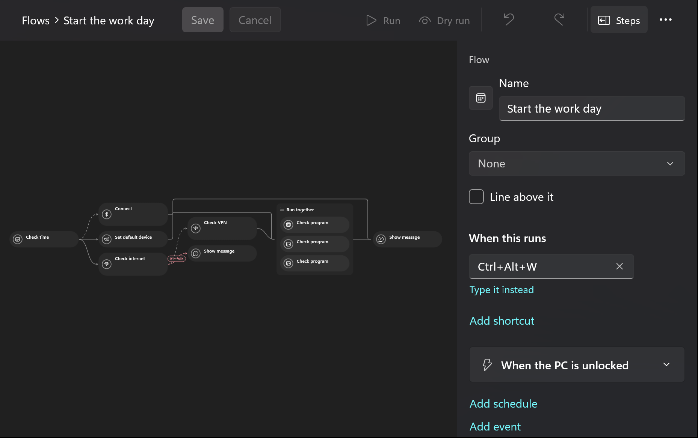

# Ctrl Alt Daze



A Windows 11 tray app that runs **flows**: named sets of steps (connect Bluetooth headphones, switch the default
audio device, change the display layout, start a program, switch the TV input…) started by a global hotkey, the tray
menu or the command line. Steps can run one after another or together, and you decide which ones may fail.

- **Engine** (`CtrlAltDaze.exe`): stays in the tray, costs next to nothing while idle (Native AOT, no UI framework).
- **Editor** (`CtrlAltDaze.Editor.exe`): opens from the tray and closes when you're done. Edit flows on a canvas,
  manage the library of devices, look at past runs.
- **`cad`**: the same from a terminal.

Per-user install, no admin rights. Windows 11 24H2 or later, x64.





## Install

Download `CtrlAltDazeApp-x64-Setup.exe` from [Releases](https://github.com/dazewell/ctrl-alt-daze/releases) and run
it. It installs to `%LOCALAPPDATA%\CtrlAltDazeApp`, adds Ctrl Alt Daze to the Start menu and starts it. The builds
aren't signed yet, so SmartScreen may ask first ("More info" › "Run anyway").

Turn on **Start with Windows** in the editor's Settings (or `cad autostart on`). Updates download in the background
once a day and install the next time Ctrl Alt Daze starts; About › Updates checks now and offers **Restart now**.
Uninstall from Settings › Apps; your flows and history stay.

## Use it

Click the tray icon for your flows, **Open Ctrl Alt Daze** (the editor) and **Pause shortcuts**. A run shows a pop-up with
each step's progress; a failure stays until you close it, and clicking it opens the editor.

Your configuration is one YAML file, `%APPDATA%\CtrlAltDaze\config.yaml`. The editor saves it as you go and keeps
backups next to it; you can also edit it by hand, and the engine reloads it when it changes. A flow with a mistake
is turned off and its problems listed; all other flows keep working. Example:

```yaml
version: 1
library:
  audio:
    headphones: { match: "Technics EAH-AZ80" }
  bluetooth:
    headphones: { address: "B8:20:8E:ED:48:FC" }
flows:
  connect-headphones:
    name: Connect headphones
    hotkeys: [Alt+Z]
    nodes:
      - { id: bt, step: bluetooth.connect, with: { device: headphones } }
      - { id: out, step: audio.setDefault, with: { device: headphones }, after: [bt] }
```

Steps: `audio.*`, `bluetooth.connect`/`disconnect`, `display.*`, `process.run`, `script.powershell`,
`http.request`, `android.*`, `service.start`/`stop`, `wait`, `notify`, `flag.*`. The editor's step palette lists them
with their settings ([docs/FEATURES.md](docs/FEATURES.md) has the whole model).

### Menu with a controller

A `menu.show` step pops up a menu of flows over every window, without taking focus. A flow with that step is started like
any other (shortcut, tray, `cad run`). Choose with the mouse, the keys (arrows, Enter, Esc, 1–9) or, while the menu is
open, an Xbox pad (a Steam Controller reaches it as arrows, Enter and Esc): D-pad or left stick to move, A to run, B to
close. Buttons already held when the menu opens are ignored until you let go. Ctrl Alt Daze reads the pad only while a menu
is open.

Known limits: games still see your pad presses while the menu is open; it shows over borderless and windowed games, not
over a game in its own full-screen mode (set the game to borderless); a key another app owns as a global shortcut won't
reach the menu; there is no screen-reader support. A Steam Controller reaches the menu only as the keys Steam's desktop layout sends (it is not a pad Windows can read); while Steam Big Picture is open Steam keeps those buttons for itself, so close Big Picture to steer the menu with it.

### Command line

```
cad run <flow> [--wait] [--dry-run]   start a flow; --dry-run shows what would happen
cad list | status | history [flow]
cad validate [file]                   problems in config.yaml
cad devices audio|bluetooth|displays|adb
cad capture-display-layout <name>     the screens as they are now, as YAML for the library
cad autostart [on|off] · cad update
```

Exit codes: 0 ok, 1 failed, 2 usage, 3 Ctrl Alt Daze isn't running.

Logs: `%LOCALAPPDATA%\CtrlAltDaze\logs` (7 days). Run history: `%LOCALAPPDATA%\CtrlAltDaze\history.jsonl`.

## Build from source

.NET 10 SDK and, for the Native AOT engine and `cad`, the MSVC C++ build tools ("Desktop development with C++").

```powershell
dotnet build CtrlAltDaze.slnx
dotnet test --solution CtrlAltDaze.slnx
pwsh scripts/install.ps1   # pack this checkout and install it like a release
```

More in [.claude/skills/build/SKILL.md](.claude/skills/build/SKILL.md). The project is written by AI agents; the
docs are their shared memory: [GOALS](docs/GOALS.md), [ARCHITECTURE](docs/ARCHITECTURE.md),
[DECISIONS](docs/DECISIONS.md), [DEADENDS](docs/DEADENDS.md), [PLAN](docs/PLAN.md), [UX](docs/UX.md).
